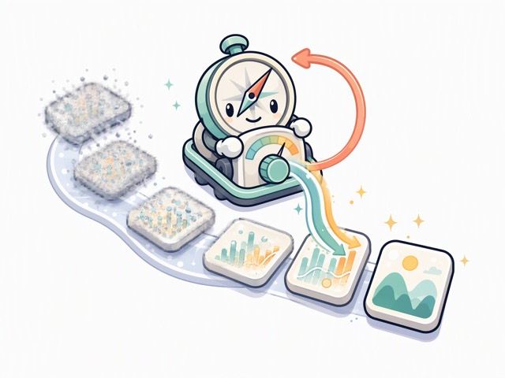
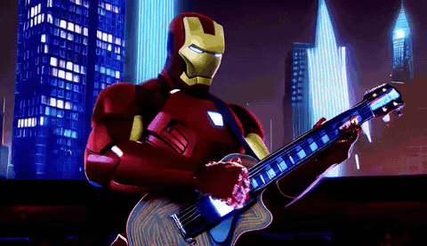
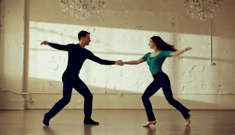
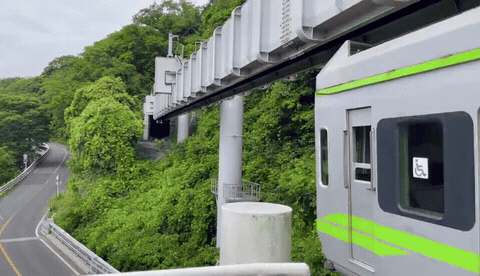

<p align="center">
  
</p>

# TrajCFG: Token-Wise Classifier-Free Guidance via Denoising Trajectory Feedback

<p align="center">
  <a href="https://jyliu-98.github.io/trajcfg-project-page/"></a>
  <a href="https://arxiv.org/abs/2610.14153"></a>
  <a href="https://github.com/jyliu-98/TrajCFG"></a>
</p>

<p align="center">
  <big><strong>
    Jingyu Liu<sup>1,†,§</sup>&ensp;
    Hao Jiang<sup>2,†</sup>&ensp;
    Yikang Ding<sup>2,‡</sup>&ensp;
    Huafeng Shi<sup>2</sup>&ensp;
    Xu Yang<sup>2</sup>&ensp;
    Xiaoqiang Liu<sup>2</sup>&ensp;
    Guoxin Zhang<sup>2</sup><br>
    Pengfei Wan<sup>2</sup>&ensp;
    Kun Gai<sup>2,*</sup>
  </strong></big>
</p>

<p align="center">
  <sup>1</sup>Renmin University of China&emsp;&emsp;
  <sup>2</sup>Kling Team, Kuaishou Technology
</p>

<p align="center">
  <sup>†</sup>Equal contribution&emsp;
  <sup>‡</sup>Project Leader&emsp;
  <sup>*</sup>Corresponding author&emsp;
  <sup>§</sup>Work done at Kling Team, Kuaishou Technology
</p>

<p align="center">
  <a href="https://jyliu-98.github.io/trajcfg-project-page/">
    
  </a>
</p>

<p align="center"><em>Qualitative results generated with TrajCFG</em></p>

| T2V · Wan2.1-T2V-1.3B | T2V · Wan2.2-T2V-A14B |
|:---:|:---:|
|  |  |
| <sub>Iron Man plays an electric guitar on a futuristic stage.</sub> | <sub>A salsa dancer spins and dips their partner.</sub> |
| **I2V · Wan2.2-I2V-A14B** | **I2V · Cosmos-Predict2.5-2B** |
|  |  |
| <sub>A monorail glides through a lush forested landscape.</sub> | <sub>A large wave crashes into a lighthouse.</sub> |

## 💡 Overview

Classifier-free guidance typically applies one shared scale to all latent
tokens, even though their velocity predictions evolve differently during
sampling. **TrajCFG** turns denoising history into a fine-grained control
signal: tokens with larger directional changes receive stronger guidance,
while tokens following more consistent trajectories receive weaker guidance.

TrajCFG is:

- **Training-free** — no fine-tuning or auxiliary model is required.
- **Token-wise** — each latent space-time location receives its own CFG scale.
- **Compute-neutral** — it reuses standard conditional and unconditional
  predictions with no additional model evaluations.
- **Modality-agnostic** — evaluated on text-to-video, image-to-video,
  text-to-audio-video, text-to-image, and image-to-3D generation.

At denoising step `k`, TrajCFG compares historical guided velocities and maps
their token-wise cosine similarity to bounded guidance scales:

$$
q_{k,p}=\cos\left(\widehat{\mathbf{v}}_{k-2,p},
\widehat{\mathbf{v}}_{k-1,p}\right),
$$

$$
s_{k,p}=s_{\min}+(s_{\max}-s_{\min})
\frac{1-q_{k,p}}{1-\rho_{\mathrm{lo}}}.
$$

From step 3 onward, adjacent-step feedback is fused with interval-normalized
stride-2 feedback using weights `0.8/0.2`.

## 🔧 Installation

```bash
git clone https://github.com/jyliu-98/TrajCFG.git
cd TrajCFG
```

### 🎞️ Wan backbones

Please follow the official installation instructions for
[Diffusers](https://github.com/huggingface/diffusers) and the corresponding
[Wan2.1](https://github.com/Wan-Video/Wan2.1) or
[Wan2.2](https://github.com/Wan-Video/Wan2.2) backbone.

### 🌌 Cosmos-Predict2.5

Please follow the official installation instructions for
[Cosmos-Predict2.5](https://github.com/nvidia-cosmos/cosmos-predict2.5) and run
the Cosmos example in its environment.

### 🔊 Text-to-audio-video backbones

Please follow the official installation instructions for
[Ovi](https://github.com/character-ai/Ovi) or
[LTX-2.3](https://github.com/Lightricks/LTX-2), then run the corresponding
example in that backbone's environment.

### 🖼️ Text-to-image backbones

Please follow the official installation instructions for
[Diffusers](https://github.com/huggingface/diffusers) and obtain the
corresponding SD3-Medium or Qwen-Image checkpoint before running the examples.

### 🧊 Image-to-3D backbone

Please follow the official installation instructions for
[Hunyuan3D-2](https://github.com/Tencent-Hunyuan/Hunyuan3D-2), then run the
shape and texture examples in its environment.

## 🚀 Usage

Every backbone is implemented as a self-contained script containing the full
TrajCFG feedback rule, denoising loop, model loading, and output handling.

### 🎬 Text-to-video

#### Wan2.1-T2V-1.3B

```bash
CUDA_VISIBLE_DEVICES=0 python examples/t2v/wan21_1_3b.py \
  --gpu 0 \
  --model-id "/path/to/Wan2.1-T2V-1.3B-Diffusers" \
  --prompt "Marvel Cinematic Universe style, Iron Man wearing his iconic red, gold, and black armor, playing an electric guitar with intricate designs and patterns. The guitar has a glossy finish and shimmering lights. Tony Stark is positioned mid-air, leaning against a sleek futuristic stage with a backdrop of New York City skyscrapers at night. He is strumming the guitar with precise movements, sparks flying from the strings. The atmosphere is intense and energetic, with colorful neon lights illuminating the room. The camera moves in and out, capturing every detail of Iron Man's agile fingers and the vibrant glow of the guitar. The scene is filled with dynamic lighting changes, emphasizing the high-tech and futuristic elements. High definition, fast-paced action shot, medium shot focusing on Iron Man's face and guitar." \
  --num-frames 81 \
  --num-inference-steps 40 \
  --base-scale 6.0 \
  --min-scale 5.0 \
  --max-scale 10.0 \
  --rho-lo 0.95
```

#### Wan2.2-TI2V-5B

```bash
CUDA_VISIBLE_DEVICES=0 python examples/t2v/wan22_5b.py \
  --gpu 0 \
  --model-id "/path/to/Wan2.2-TI2V-5B-Diffusers" \
  --prompt "A cat paws at a dangling yarn ball, causing it to swing in a pendulum motion while the cat tries to grab it again." \
  --num-frames 81 \
  --num-inference-steps 40 \
  --base-scale 5.0 \
  --min-scale 3.0 \
  --max-scale 10.0 \
  --rho-lo 0.95
```

#### Wan2.2-T2V-A14B

```bash
CUDA_VISIBLE_DEVICES=0 python examples/t2v/wan22_14b.py \
  --gpu 0 \
  --model-id "/path/to/Wan2.2-T2V-A14B-Diffusers" \
  --prompt "A salsa dancer spins their partner rapidly, then dips them low to the ground, pausing for a beat before pulling them back up." \
  --num-frames 81 \
  --num-inference-steps 40 \
  --base-scale 3.5 \
  --min-scale 1.0 \
  --max-scale 10.0 \
  --rho-lo 0.90
```

### 🎞️ Image-to-video

#### Wan2.2-TI2V-5B

```bash
CUDA_VISIBLE_DEVICES=0 python examples/i2v/wan22_5b.py \
  --gpu 0 \
  --model-id "/path/to/Wan2.2-TI2V-5B-Diffusers" \
  --image "assets/i2v/wan22_5b.jpeg" \
  --prompt "The video opens with a scene set in a modern, well-lit indoor space, likely a café or exhibition area, characterized by a clean and contemporary design. The background reveals a spacious area with several people seated at tables, engaged in conversation or activities, and potted plants adding a touch of greenery. In the foreground, two robotic arms with white mechanical components and black gloves are positioned at a table. The right robotic hand is holding a red cup with a black lid, which has a festive design featuring snowflakes and other holiday motifs. To the left of the robotic arms, there is a white cup containing what appears to be breadsticks or similar snacks. As the video progresses, the robotic arms begin to move slightly, adjusting the grip on the cup. A woman standing behind the robotic arm then reaches out with her right hand, gently taking the cup from the robotic arm's grasp. The woman holds the cup steadily, examining it closely by rotating it slightly in her hands. The robotic arm remains in place, with its fingers still extended towards the cup but no longer in contact with it. The person continues to hold the cup, while the robotic arm stays stationary, maintaining its initial position at the table. A medium shot captures the interaction between the robotic arm and the woman, highlighting the smooth transition of the cup from the machine to human hands. The setting is bright and inviting, with a mix of modern technology and casual human activity, creating a juxtaposition between automation and human connection." \
  --num-frames 81 \
  --num-inference-steps 40 \
  --base-scale 5.0 \
  --min-scale 2.0 \
  --max-scale 10.0 \
  --rho-lo 0.95
```

#### Wan2.2-I2V-A14B

```bash
CUDA_VISIBLE_DEVICES=0 python examples/i2v/wan22_14b.py \
  --gpu 0 \
  --model-id "/path/to/Wan2.2-I2V-A14B-Diffusers" \
  --image "assets/i2v/wan22_14b.jpeg" \
  --prompt "A sleek, modern monorail train glides through a lush, forested landscape. The scene opens with an eye-level long shot, capturing the train's light-gray exterior adorned with green stripes as it moves steadily from right to left. Supported by sturdy pillars, the monorail infrastructure features parallel metallic beams with a smooth underside. The train approaches a dark rectangular tunnel seamlessly integrated into the hillside. Inside the train, passengers can be seen through the windows, with a handicap sign sticker and a stylized 'M' sticker visible on the first and last coaches. The train's backside displays three large glass panels, with rain wipers installed and a white sticker featuring a cartoon character holding a rainbow over its head. Inside the operator's room, a person in a white shirt is seen standing. The train's headlights are located at the very bottom of the backside. The camera pans slightly left for the first half of the clip, then tilts down for the rest, focusing on the side view of the train as it travels past. Below the train, a winding two-lane road snakes through the scene, marked by light orange lines and flanked by safety railings. The backdrop is a vibrant green forest under a bright, clear sky, enhancing the train's smooth journey and intricate details." \
  --num-frames 81 \
  --num-inference-steps 40 \
  --base-scale 2.5 \
  --min-scale 1.0 \
  --max-scale 7.0 \
  --rho-lo 0.95
```

#### Cosmos-Predict2.5-2B

```bash
CUDA_VISIBLE_DEVICES=0 python examples/i2v/cosmos_predict2_5_2b.py \
  --checkpoint-path "/path/to/Cosmos-Predict2.5-2B" \
  --image "assets/i2v/cosmos_predict2_5.jpeg" \
  --prompt "a large wave crashes into a lighthouse." \
  --num-frames 81 \
  --num-inference-steps 35 \
  --base-scale 5.0 \
  --min-scale 4.0 \
  --max-scale 9.0 \
  --rho-lo 0.90
```

### 🔊 Text-to-audio-video

#### Ovi 1.1

```bash
CUDA_VISIBLE_DEVICES=0 python -m examples.t2av.ovi \
  --gpu 0 \
  --model-path "/path/to/Ovi-model" \
  --wan-path "/path/to/Wan2.2-TI2V-5B" \
  --ckpt-dir "/path/to/Ovi/ckpts" \
  --prompt "A dramatic close-up shot focuses on a young man, his face etched with intense concentration, seated in a dimly lit room where his features are illuminated only by the dynamic, flickering glow of a large monitor off-screen. The air is thick with the thunderous sounds of intense video game combat—explosions, rapid gunfire, and urgent in-game callouts. As the camera performs a slow, dramatic dolly-in, the chaotic combat audio cuts out abruptly, replaced by the stark, repetitive beep of a low-battery game controller. The man's focused expression shatters into wide-eyed panic as he shouts in a frantic, high-pitched voice, \"No, no, no! My controller died! REVIVE ME!\"" \
  --sample-steps 50 \
  --base-scale 3.5 \
  --min-scale 3.5 \
  --max-scale 10.0 \
  --rho-lo 0.95
```

#### LTX-2.3

```bash
CUDA_VISIBLE_DEVICES=0 python examples/t2av/ltx2_3.py \
  --gpu 0 \
  --model-root "/path/to/LTX-2.3" \
  --gemma-root "/path/to/gemma-3-12b" \
  --prompt "In a medium shot with a somber, cinematic style, a young man in a rain-dampened jacket stands anxiously in a dimly lit apartment hallway. He raises a hesitant hand and knocks three times on a dark wooden door. The sound design features the sharp, echoing sound of the knocks, followed by the click of a lock turning and the slow creak of the door opening. His friend appears in the doorway, a look of concern on his face." \
  --num-frames 97 \
  --num-inference-steps 30 \
  --base-scale 5.0 \
  --min-scale 4.0 \
  --max-scale 9.0 \
  --rho-lo 0.90
```

### 🖼️ Text-to-image

#### Stable Diffusion 3 Medium

```bash
CUDA_VISIBLE_DEVICES=0 python examples/t2i/sd3_medium.py \
  --gpu 0 \
  --model-id "/path/to/stable-diffusion-3-medium-diffusers" \
  --prompt "a photo of a dog right of a teddy bear" \
  --num-inference-steps 28 \
  --base-scale 7.0 \
  --min-scale 6.0 \
  --max-scale 9.0 \
  --rho-lo 0.95
```

#### Qwen-Image-2512

```bash
CUDA_VISIBLE_DEVICES=0 python examples/t2i/qwen_image.py \
  --gpu 0 \
  --model-id "/path/to/Qwen-Image-2512" \
  --prompt "a photo of three baseball bats" \
  --num-inference-steps 30 \
  --base-scale 5.0 \
  --min-scale 4.0 \
  --max-scale 9.0 \
  --rho-lo 0.95
```

### 🧊 Image-to-3D

#### Hunyuan3D-2 shape generation

```bash
CUDA_VISIBLE_DEVICES=0 python examples/i2_3d/shape.py \
  --gpu 0 \
  --model-path "/path/to/Hunyuan3D-2" \
  --image "assets/i2_3d/386.jpeg" \
  --num-inference-steps 50 \
  --base-scale 7.0 \
  --min-scale 5.0 \
  --max-scale 9.0 \
  --rho-lo 0.95
```

#### Hunyuan3D-2 texture generation

```bash
CUDA_VISIBLE_DEVICES=0 python examples/i2_3d/texture.py \
  --gpu 0 \
  --model-path "/path/to/Hunyuan3D-2" \
  --image "assets/i2_3d/386.jpeg" \
  --mesh "assets/i2_3d/386.glb" \
  --num-inference-steps 50 \
  --base-scale 2.0 \
  --min-scale 2.0 \
  --max-scale 3.0 \
  --rho-lo 0.95
```

The commands above use the exact prompts of the provided qualitative examples.
Input paths, prompts, model paths, CUDA devices, seeds, output paths, and
TrajCFG hyperparameters can all be overridden through command-line arguments.
Outputs are written to `outputs/`; every generated result is accompanied by a
JSON file containing the generation settings and per-step scale statistics.

## ⚙️ Reproduced settings

| Task | Backbone | `s_base` | `s_min` | `s_max` | `rho_lo` | Steps |
|:---:|---|---:|---:|---:|---:|---:|
| T2V | Wan2.1-T2V-1.3B | 6.0 | 5.0 | 10.0 | 0.95 | 40 |
| T2V | Wan2.2-TI2V-5B | 5.0 | 3.0 | 10.0 | 0.95 | 40 |
| T2V | Wan2.2-T2V-A14B | 3.5 | 1.0 | 10.0 | 0.90 | 40 |
| I2V | Wan2.2-TI2V-5B | 5.0 | 2.0 | 10.0 | 0.95 | 40 |
| I2V | Wan2.2-I2V-A14B | 2.5 | 1.0 | 7.0 | 0.95 | 40 |
| I2V | Cosmos-Predict2.5-2B | 5.0 | 4.0 | 9.0 | 0.90 | 35 |
| T2AV | Ovi 1.1 | 3.5 | 3.5 | 10.0 | 0.95 | 50 |
| T2AV | LTX-2.3 | 5.0 | 4.0 | 9.0 | 0.90 | 30 |
| T2I | Qwen-Image | 5.0 | 4.0 | 9.0 | 0.95 | 30 |
| T2I | SD3-Medium | 7.0 | 6.0 | 9.0 | 0.95 | 28 |
| I2-3D | Hunyuan3D-2 Shape | 7.0 | 5.0 | 9.0 | 0.95 | 50 |
| I2-3D | Hunyuan3D-2 Texture | 2.0 | 2.0 | 3.0 | 0.95 | 50 |

These defaults match Table 7 of the paper. All examples use adjacent/stride-2
fusion weights `(0.8, 0.2)`.

## 📁 Repository structure

```text
TrajCFG/
├── examples/
│   ├── t2v/                 # Self-contained text-to-video examples
│   ├── i2v/                 # Self-contained image-to-video examples
│   ├── t2av/                # Self-contained text-to-audio-video examples
│   ├── t2i/                 # Self-contained text-to-image examples
│   └── i2_3d/               # Self-contained image-to-3D examples
├── assets/
│   ├── i2v/                 # I2V conditioning images
│   └── i2_3d/               # I2-3D images and meshes
└── README.md
```

## 📎 Citation

If you find this work useful, please consider citing:

```bibtex
@misc{liu2026trajcfg,
  title         = {TrajCFG: Token-Wise Classifier-Free Guidance via Denoising Trajectory Feedback},
  author        = {Jingyu Liu and Hao Jiang and Yikang Ding and Huafeng Shi and
                   Xu Yang and Xiaoqiang Liu and Guoxin Zhang and Pengfei Wan and Kun Gai},
  year          = {2026},
  eprint        = {2610.14153},
  archivePrefix = {arXiv},
  primaryClass  = {cs.CV},
  url           = {https://arxiv.org/abs/2610.14153}
}
```

## 🤝 Acknowledgements

This repository builds upon the following open-source projects:

- [Diffusers](https://github.com/huggingface/diffusers), including its
  [Wan pipelines](https://github.com/huggingface/diffusers/tree/main/src/diffusers/pipelines/wan).
- [Wan2.1](https://github.com/Wan-Video/Wan2.1) and
  [Wan2.2](https://github.com/Wan-Video/Wan2.2).
- [Cosmos-Predict2.5](https://github.com/nvidia-cosmos/cosmos-predict2.5).
- [Ovi](https://github.com/character-ai/Ovi).
- [LTX-2.3](https://github.com/Lightricks/LTX-2).
- [Stable Diffusion 3](https://huggingface.co/stabilityai/stable-diffusion-3-medium-diffusers).
- [Qwen-Image](https://huggingface.co/Qwen/Qwen-Image-2512).
- [Hunyuan3D-2](https://github.com/Tencent-Hunyuan/Hunyuan3D-2).
